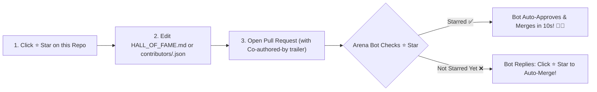

# 🏆 GitHub Achievements Arena (`Star-to-Auto-Merge Bot`)

[-brightgreen?style=for-the-badge&logo=githubactions)](https://github.com/khoap1220-hue/github-achievements-arena/actions)
[](https://github.com/khoap1220-hue/github-achievements-arena/stargazers)
[](https://github.com/khoap1220-hue/github-achievements-arena/pulls)
[](https://github.com/khoap1220-hue/github-achievements-arena/discussions)

Welcome to **GitHub Achievements Arena** — an automated, zero-wait open-source arena powered by **GitHub Actions** where developers from around the world can unlock and level up their **GitHub Profile Achievements** (`🦈 Pull Shark`, `👯 Pair Extraordinaire`, `⚡ Quickdraw`, `🧠 Galaxy Brain`, and `🚀 YOLO`) in **under 60 seconds**!

---

## ⚡ How the `Star-to-Auto-Merge` Bot Works (3 Simple Steps)

> [!IMPORTANT]
> **Rule #1 (The Star Gate ⭐):** Our automated GitHub Actions Bot checks if your GitHub account has **Starred (`⭐`)** this repository before merging your Pull Request.
> **Why?** Every Star helps more developers discover the Arena! Once you click **⭐ Star** at the top-right of this page, the bot will **automatically Approve and Merge your PR within 10 seconds**!



---

## 🎯 Complete Achievement Unlocking Matrix

| Badge | Achievement Name | Tiers (`Default` / `Bronze x2` / `Silver x3` / `Gold x4`) | How to Unlock in This Arena | Speed |
| :---: | :--- | :--- | :--- | :---: |
| 🦈 | **Pull Shark** | `2` / `16` / `128` / `1,024` Merged PRs | **1.** Click **⭐ Star** on this repo.<br>**2.** Add your row to [`HALL_OF_FAME.md`](./HALL_OF_FAME.md) or create `contributors/<your-username>.json`.<br>**3.** Open a Pull Request — **Arena Bot auto-merges it in 10s!** | **⚡ 10 sec** |
| 👯 | **Pair Extraordinaire** | `1` / `10` / `24` / `48` Co-Authored Merged PRs | Include this exact trailer at the bottom of your commit message when opening your PR:<br>`Co-authored-by: Khoa Phan <233728558+khoap1220-hue@users.noreply.github.com>` | **⚡ 10 sec** |
| ⚡ | **Quickdraw** | `1x` (100% Unlocked) | Open an Issue in [Issues](https://github.com/khoap1220-hue/github-achievements-arena/issues/new) with `[Quickdraw]` in the title — **Arena Bot (`quickdraw-arena.yml`) will automatically greet you and close it within 15 seconds** (or close it yourself within 5 minutes)! | **⚡ 15 sec** |
| 🧠 | **Galaxy Brain** | `2` / `8` / `16` / `32` Accepted Answers | Head to our [Q&A Discussions](https://github.com/khoap1220-hue/github-achievements-arena/discussions/categories/q-a): post a technical question for others to answer, and answer open community questions to get marked as **Accepted Answer**! | **⚡ 2 min** |
| 🚀 | **YOLO** | `1x` (100% Unlocked) | On your own fork or repo, open a PR, request a code review from a collaborator, and merge the PR before they review it (see [`docs/UNLOCK_ALL_BADGES_GUIDE.md`](./docs/UNLOCK_ALL_BADGES_GUIDE.md)). | **⚡ 1 min** |
| 🌟 | **Starstruck** | `16` / `128` / `512` / `4,096` Stars | Add your best open-source repository link in [`HALL_OF_FAME.md`](./HALL_OF_FAME.md) so fellow Arena contributors can check out and **⭐ Star** your project back! | **🤝 Community** |

---

## 🚀 Step-by-Step: Unlock `🦈 Pull Shark` + `👯 Pair Extraordinaire` Right Now

### Option A — 100% In Your Browser (No Terminal Needed)
1. **Click the `⭐ Star` button** at the top-right of [`khoap1220-hue/github-achievements-arena`](https://github.com/khoap1220-hue/github-achievements-arena).
2. Open [`HALL_OF_FAME.md`](./HALL_OF_FAME.md) and click the **✏️ Edit (Pencil)** icon.
3. Add your row at the bottom of the table:
   ```markdown
   | @your-username | Your Name | 🦈 Pull Shark, 👯 Pair Extraordinaire | [My Featured Repo](https://github.com/your-username) |
   ```
4. In the **Commit changes** box:
   - **Commit message:** `feat(arena): add @your-username to Hall of Fame`
   - **Extended description (paste this exact line to unlock `👯 Pair Extraordinaire`):**
     ```text
     Co-authored-by: Khoa Phan <233728558+khoap1220-hue@users.noreply.github.com>
     ```
5. Select **"Create a new branch for this commit and start a pull request"** and click **Propose changes -> Create pull request**.
6. Watch the **Arena Auto-Merge Bot** verify your `⭐ Star`, approve your PR, and merge it automatically within 10 seconds! 🎉

---

### Option B — Command Line (`git` + `gh` CLI)
```bash
# 1. Star & Fork the repository
gh repo star khoap1220-hue/github-achievements-arena
gh repo fork khoap1220-hue/github-achievements-arena --clone
cd github-achievements-arena

# 2. Create a branch and add your contributor profile
git checkout -b feat/add-$(gh api user -q .login)
python scripts/register_contributor.py --username "$(gh api user -q .login)"

# 3. Commit with the Co-authored-by trailer for Pair Extraordinaire
git add contributors/ HALL_OF_FAME.md
git commit -m "feat(arena): register contributor profile

Co-authored-by: Khoa Phan <233728558+khoap1220-hue@users.noreply.github.com>"

# 4. Push and open Pull Request
git push -u origin HEAD
gh pr create --fill
```

---

## 🛡️ Security & Safe Auto-Merge Architecture

To keep the Arena 100% safe for everyone, our `.github/workflows/auto-merge-arena.yml` workflow enforces strict guardrails:
1. **Path Allowlist Only:** The bot ONLY auto-merges Pull Requests that touch `HALL_OF_FAME.md` or `contributors/*.json`. Any PR modifying `.github/`, `scripts/`, or code files is blocked from auto-merge and routed for manual maintainer inspection.
2. **Star Verification Gate:** The bot queries the GitHub Stargazers API to confirm the PR author has starred `khoap1220-hue/github-achievements-arena`. If you forgot to star first, simply click **⭐ Star** on the repository — our `star-triggered-merge.yml` workflow detects your new Star event and merges your waiting PR automatically!

---

## 📜 License

MIT License — Created and maintained by [**Khoa Phan (`@khoap1220-hue`)**](https://github.com/khoap1220-hue). Don't forget to **⭐ Star** and share with fellow developers!
